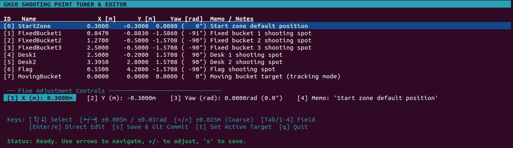

# gn10_shot_manager

高専ロボコン2026ロボット用 **投擲目標ポイント微調整エディタ (TUI)** 兼 **射出試行同期レコーダー (Trial Recorder)** パッケージ。

---

## 概要

- **Shooting Editor (TUI)**: SSH接続端末上でも軽量かつ確実に動作するターミナルGUI。`shooting_points.yaml` の各ターゲット座標（X, Y, Yaw）をミリメートル/センチメートル単位で微調整し、メモを追加、ROS 2サービス (`/target_manager/update_point`, `/target_manager/save_points`) 経由でロボットのメモリおよび設定ファイルへ反映・保存・Git自動コミットを行います。



- **Trial Recorder**: ロボットの射出カウンタトピック (`/robot/feedback/shot_count`) を監視し、射出トリガ発火時に同一時間軸でロボットの各種センサ（ベルト速度、電圧、電流、目標値）と RealSense による雑巾追跡位置 (`/cloth/position`) をサンプリング・同期記録（JSON Lines 形式）。
- **Trial Viewer**: 記録された各試行ログから着弾精度やターゲットごとの統計（平均誤差、標準偏差、ピーク電流等）を表示。

---

## 主な機能とキー操作

### 1. Shooting Editor (`shooting_editor`)

ターミナルから起動:
```bash
ros2 run gn10_shot_manager shooting_editor
```

#### キーバインド一覧:
| キー | 操作内容 |
|---|---|
| `↑` / `↓` (`k` / `j`) | ターゲット行の選択 (Target 0～7) |
| `←` / `→` (`h` / `l`) | 選択中フィールドの微小調整 (`±0.005m`, `±0.01rad`) |
| `+` / `-` | 選択中フィールドの微小加算 / 減算 |
| `>` / `<` | 選択中フィールドの粗調整 (`±0.025m`) |
| `Tab` / `1`〜`4` | 調整フィールドの切替 (`1: X`, `2: Y`, `3: Yaw`, `4: Memo`) |
| `Enter` / `e` | 直接数値・テキスト入力編集 |
| `s` | **保存 & Gitコミット** (`UpdatePoint` → `SavePoints` → `git commit`) |
| `r` | YAMLファイルからの再読み込み |
| `t` | 現在選択中の TargetId を `/robot/target_id` へ配信（目標送信） |
| `q` / `ESC` | 終了（未保存変更がある場合は確認プロンプト表示） |

---

### 2. Trial Recorder (`trial_recorder`)

バックグラウンドまたは別ターミナルで起動:
```bash
ros2 run gn10_shot_manager trial_recorder
# または
ros2 launch gn10_shot_manager shot_manager.launch.py
```

- **トリガ**: `/robot/feedback/shot_count` のインクリメント（原点取り時の0リセットは無視）
- **保存先**: `~/ros2_ws/data/trials/trials.jsonl`
- **記録データ**:
  - `shot_id`, `timestamp`, `target` (id, name, x, y, yaw, memo)
  - `summary`: 最大速度、最大電流、平均電圧
  - `landing_position`: 雑巾着弾座標
  - `error`: 着弾誤差（dx, dy, distance）
  - `samples`: 50Hz (20ms刻み) で同期された時系列データ

---

### 3. Trial Viewer (`trial_viewer`)

```bash
# 全体サマリー & ターゲット別着弾精度統計
ros2 run gn10_shot_manager trial_viewer

# 最新の試行の詳細データ表示
ros2 run gn10_shot_manager trial_viewer --last

# 特定の Shot ID (例: 1) の時系列データ表示
ros2 run gn10_shot_manager trial_viewer --shot 1
```

---

## 連携トピック・サービス仕様

| 名前 | 型 | 種別 | 説明 |
|---|---|---|---|
| `/target_manager/update_point` | `gn10_navigation/srv/UpdatePoint` | Client | メモリ上ポイント更新 |
| `/target_manager/save_points` | `std_srvs/srv/Trigger` | Client | ファイル永続化保存 |
| `/robot/feedback/shot_count` | `std_msgs/msg/UInt8` | Sub/Pub | メイン基板の射出回数カウンタ（原点取り0、射出命令でインクリメント） |
| `/robot/feedback/belt_launcher/*` | `std_msgs/msg/Float32` | Sub | ベルト速度・電圧・電流・目標値 |
| `/robot/feedback/drive_*` | `std_msgs/msg/Float32` | Sub | 走行バッテリー電圧・電流 |
| `/cloth/position` | `geometry_msgs/msg/PointStamped` | Sub | 雑巾の3D位置 (RealSense追跡) |
| `/cloth/measured_path` | `nav_msgs/msg/Path` | Sub | 雑巾の飛行軌跡パス |

